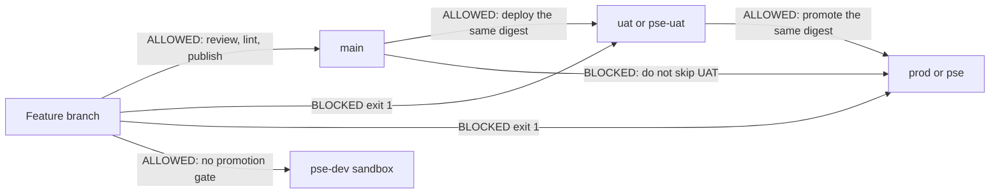
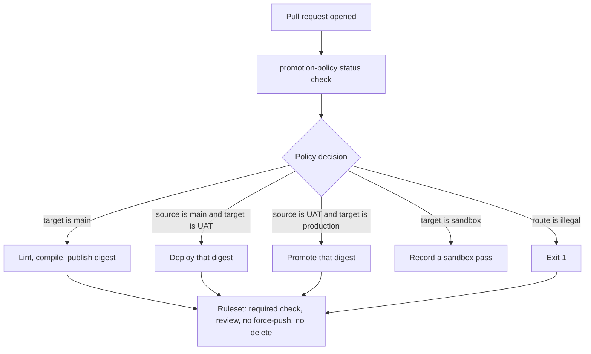
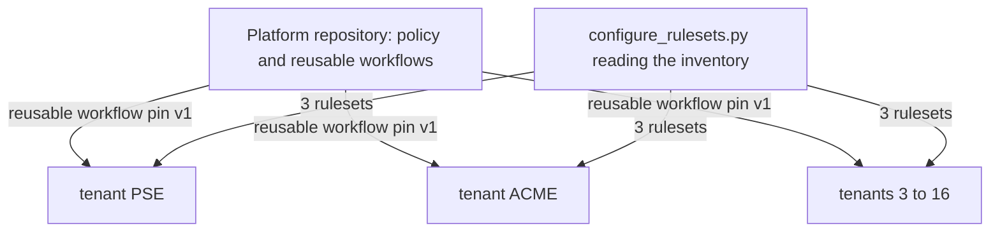

# 2. High-level solution

## The control, in one paragraph

Every tenant repository promotes code in one direction: feature branch to `main`, `main` to UAT, UAT to production. A single Python decision implements that matrix and returns exit 0 or exit 1. GitHub Actions runs that decision as a required status check. A ruleset on each governed branch makes the check, a pull request, and a review mandatory, and it blocks force-push and deletion. Sandbox branches such as `pse-dev` have no ruleset. One script writes the three rulesets into all 16 repositories.

## Route map



PSE is the tenant slug in the pilot. In the ACME repository the production branch is `acme`, and a branch named `pse` is only a sandbox branch. The tenant is a property of the repository. It is not guessed from the branch name.

## What each route does

| Source → target | Result | What runs |
| --- | --- | --- |
| Any branch → `main` | Allowed | Review, lint, compile, publish one digest to Artifact Registry |
| `main` → `uat` or `<tenant>-uat` | Allowed | Deploy that digest to UAT. No compile |
| Any other branch → UAT | Blocked, exit 1 | The client's sentence: changes must merge into `main` first |
| `uat` or `<tenant>-uat` → `prod` or `<tenant>` | Allowed | Promote the UAT digest into production. No compile |
| Any other branch → production, including `main` → production | Blocked, exit 1 | The client's sentence: no direct feature PR, and no skipping UAT |
| Feature branch → any other branch, such as `<tenant>-dev` | Allowed | Experiment. No ruleset, no publish |

A hotfix returns through `main`. `pse` can merge back to `main`, because any branch may enter `main`. `pse` cannot merge straight back into `pse-uat`. The forward ladder is the only way up.

## Why there are two mechanisms



The policy is the brain. The ruleset is the lock. Either one alone is incomplete.

- A workflow that is not required can be skipped by someone with push access.
- A ruleset that only says "checks must pass" still cannot name the legal source branch. GitHub binds a ruleset to the **target** ref. There is no source-branch condition in the ruleset API.

So the required check context on UAT is `promotion-policy` together with `deploy-uat`. The job always runs for that target, including for illegal sources, and the illegal source makes the job exit 1. The pull request goes red. It does not sit pending.

## Build once, promote the digest

The artifact URI is a pure function of tenant and git SHA:

```text
simulated://artifact-registry/tenants/pse/app@sha256:917e0337b8ad83636d8ac894d6e89e6f19255dc40f47ebb62b16d006262a9da4
```

That URI came from SHA `demo-sha`. Publishing it, deploying it to UAT, and promoting it to production all produce the same string. UAT and production manifests say `"compilation": "not-performed"`.

Two publish moments:

1. The pull request into `main` lints, compiles, and publishes the candidate so the reviewer can see a green build.
2. After the merge, the push to `main` publishes the merge-commit SHA. The UAT pull request's head is that SHA, and the UAT job deploys it without compiling.

The registry client in this exercise writes a manifest and uploads it as a GitHub Actions artifact. In the client estate the same two steps call Artifact Registry. The route decision does not change. Authentication to the real registry should be OIDC from GitHub to the cloud project, so the workflow does not store a long-lived key.

## The three rulesets

Sandbox branches are absent from all three. That absence is the sandbox.

| Ruleset | Branches for PSE | Reviews | Required checks, local style |
| --- | --- | --- | --- |
| `enterprise-integration-main` | `main` | 1 | `promotion-policy`, `build-and-publish` |
| `enterprise-uat-gate` | `uat`, `pse-uat` | 1 | `promotion-policy`, `deploy-uat` |
| `enterprise-production-gate` | `prod`, `pse` | 2, and the latest push must be approved | `promotion-policy`, `promote-prod` |

Every ruleset also requires a pull request, dismisses stale reviews, requires conversation resolution, blocks deletion, and blocks force-push. `bypass_actors` is empty. Branch creation stays open (`do_not_enforce_on_create`) so the pilot can create `pse-uat` once. Later updates to that branch need a pull request.

An organization ruleset with a wildcard cannot replace these. A pattern that meant "the production branch named after whichever tenant this is" would also match feature branches. Production branches differ per repository (`pse`, `acme`, …), so the ruleset has to be repository-scoped. That is why the work is 3 × 16 and why it has to be generated.

## One platform, sixteen callers



This pilot repository is the platform. Its own workflows run on `pull_request`, so the check name is the job name: `promotion-policy`.

A tenant repository does not copy the policy. `scripts/render_tenant.py` writes callers like this:

```yaml
jobs:
  deploy-uat:
    name: deploy-uat
    uses: OWNER/platform-workflows/.github/workflows/deploy-uat.yml@v1
    with:
      tenant: pse
      platform_repository: OWNER/platform-workflows
      platform_ref: v1
```

The generated files are in `templates/tenant-pse/`. The branch list in that caller and the branch list in the UAT ruleset both come from `branch_spec("pse")`. A test fails if they diverge.

GitHub reports a reusable-workflow check as `<caller job> / <called job>`. For these callers that is `promotion-policy / promotion-policy`. `desired_rulesets(tenant, "reusable")` requires that string. `desired_rulesets(tenant, "local")` requires the short name used by this pilot. The first PSE pull request is where you confirm the string, before `--apply`.

Pin callers to a tag (`v1`) before the 16-repository rollout. This repository can use `@main` for the first personal-account demo.

## Fail-closed behavior

| Situation | Result |
| --- | --- |
| Feature to UAT or production | Exit 1. The log prints the client's sentence |
| `main` to production | Exit 1. Skipping UAT is the same production rule |
| Target branch `Main`, `UAT`, `Prod`, or `PSE` | Exit 1. A case variant of a governed name is blocked, so it cannot be used as an ungoverned sandbox |
| Empty source or target | Exit 1 |
| Unknown tenant slug, or a slug of `main` / `uat` / `prod` | Exit 1. The program refuses to guess |
| Someone deletes the workflow to avoid the check | The ruleset waits for a check that never comes. The pull request cannot merge |
| UAT or production job is pointed at a compile step by mistake | The contract test reads the workflow and fails if `policy.lint` appears in the UAT or production file |

## What a tenant can still try

A tenant with write access could replace the caller with a job of the same name that exits 0. The required check would go green. Two controls cover that.

1. Changing `.github/workflows` is itself a pull request into `main`, so it needs the review count and a green policy check. On production paths it needs two approvals.
2. A scheduled `--check` diffs the live rulesets. A second audit diffs the caller file against `render_callers()`. On GitHub Enterprise, a ruleset workflow rule can pin the exact file in the platform repository. That pin is phase 2. It is not available on a free personal account, so the pilot does not pretend it is.

## Applying the rulesets

Dry-run is the default. It prints the JSON and does not call GitHub.

```bash
python3 scripts/configure_rulesets.py \
  --repo OWNER/github-abacus-task \
  --tenant pse \
  --caller-style local
```

`--apply` creates a missing ruleset and updates a drifted one. It does not delete rulesets it does not own. `--check` exits 1 when the live objects differ from the generated ones. The API version header is `2026-03-10`.

## Phase 2, after the pilot is accepted

| Item | Why it waits |
| --- | --- |
| Real Artifact Registry push, via OIDC | The task asks us to simulate publish. The digest contract is already tested |
| Ruleset enforcement `evaluate` on Enterprise, then `active` | Personal accounts enforce immediately. Enterprise can watch a week of would-have-blocked traffic |
| Workflow rule that pins the platform file | Enterprise only. Closes the "replace the caller with exit 0" hole without relying on review alone |
| CODEOWNERS on `.github/workflows` and `policy/` | Needs the client's team name. One line once the team exists |
